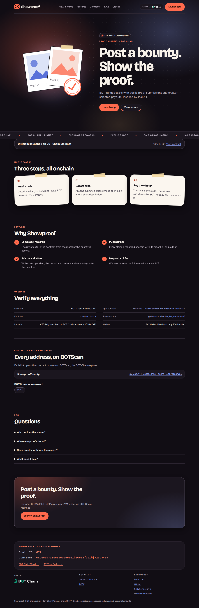

# Showproof

**Post a bounty. Show the proof.** BOT-funded tasks with public proof submissions and creator-selected payouts. Inspired by POIDH.

**Officially launched on BOT Chain Mainnet** on 2026-10-22.

- Website and app: https://showproofbot.vercel.app (app at [`/app/`](https://showproofbot.vercel.app/app/))
- Network: BOT Chain mainnet, chain ID 677 · [BOT Chain](https://www.botchain.ai/) · [BOTScan](https://scan.botchain.ai/)
- X: [@Showproof_fi](https://x.com/Showproof_fi)



## How it works

1. **Fund a task.** Describe what you need and lock a BOT reward in the contract.
2. **Collect proof.** Anyone submits a public image or IPFS link with a short description.
3. **Pay the winner.** You award one claim. The winner withdraws the BOT; nobody else can touch it.

## Features

- **Escrowed rewards.** The reward sits in the contract from the moment the bounty is posted.
- **Public proof.** Every claim is recorded onchain with its proof link and author.
- **Fair cancellation.** With claims pending, the creator can only cancel seven days after the deadline.
- **No protocol fee.** Winners receive the full reward in native BOT.

## Contracts

| Contract | BOT Chain mainnet |
|---|---|
| `ShowproofBounty` | [`0xde89a711cc8905e96661b30683fce1bf7235343a`](https://scan.botchain.ai/address/0xde89a711cc8905e96661b30683fce1bf7235343a) |

BOT Chain infrastructure used: USDT `0xaBabc7Ddc03e501d190C676BF3d92ef0e6e87a3C`, WBOT `0xD5452816194a3784dBa983426cCe7c122F4abd30`, BDEX router `0x07032d47A1b9f8460cBeE9dC17c1d3E438693929`, BDEX QuoterV2 `0x034A705b36067cff99ABf5C662Be881cBd8d0176`.

Source: [`contracts/src`](contracts/src). Tests: [`contracts/test`](contracts/test). The contracts are unaudited; use small amounts.

## Develop

Requires Node 20+, [Foundry](https://getfoundry.sh) and Python 3.

```bash
git clone --recursive https://github.com/David-glitc/showproof.git
cd showproof
npm ci
npm test              # forge test
npm run build         # landing page + app into dist/showproof
npm run preview       # http://127.0.0.1:8771
```

`npm run build` writes `dist/showproof/index.html` (landing page), `dist/showproof/app/` (the dApp) and a Cloudflare Workers bundle under `sites/`.

### Wallets

The app discovers installed wallets with EIP-6963 (BO Wallet, MetaMask, OKX, Rabby and others) and falls back to `window.ethereum`. It switches or adds BOT Chain (chain ID `0x2a5`, RPC `https://rpc.botchain.ai`) before any transaction, and simulates every call before asking for a signature.

### Rehearse on a mainnet fork

```bash
anvil --fork-url https://rpc.botchain.ai --port 8677 --chain-id 677
export BOT_RPC_URL=http://127.0.0.1:8677
node scripts/deploy.mjs && node scripts/fork-check.mjs
```

### Deploy

`scripts/deploy.mjs` reads the deployer key from `BOT_SIGNER_FILE` (default `~/.config/botchain-wave1/deployer.env`, never committed), refuses to broadcast on mainnet without `BOT_MAX_GAS_BOT`, and journals every transaction to `deployments/mainnet.json` so it can resume. `npm run publish` deploys the built site to Vercel as a static production deployment.

## License

MIT. Built on [BOT Chain](https://www.botchain.ai/).
